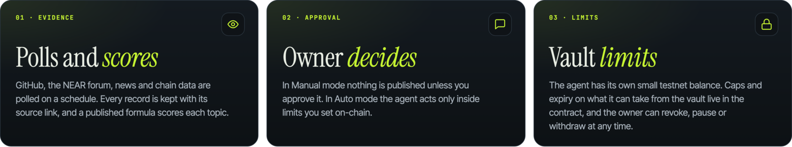
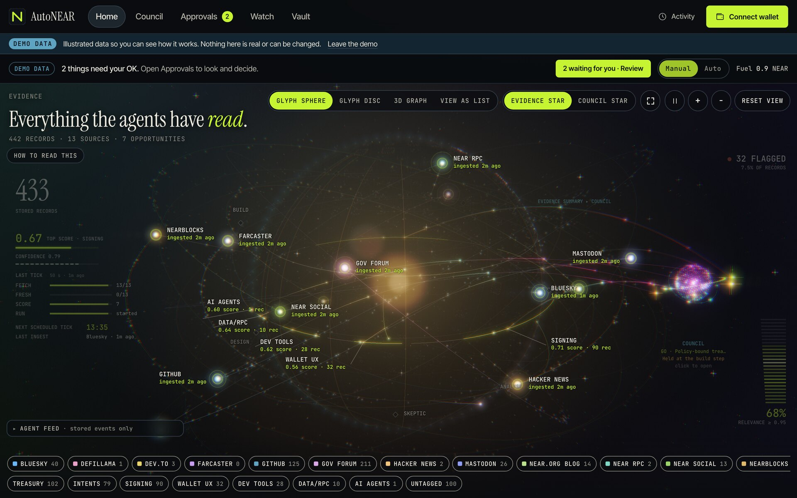
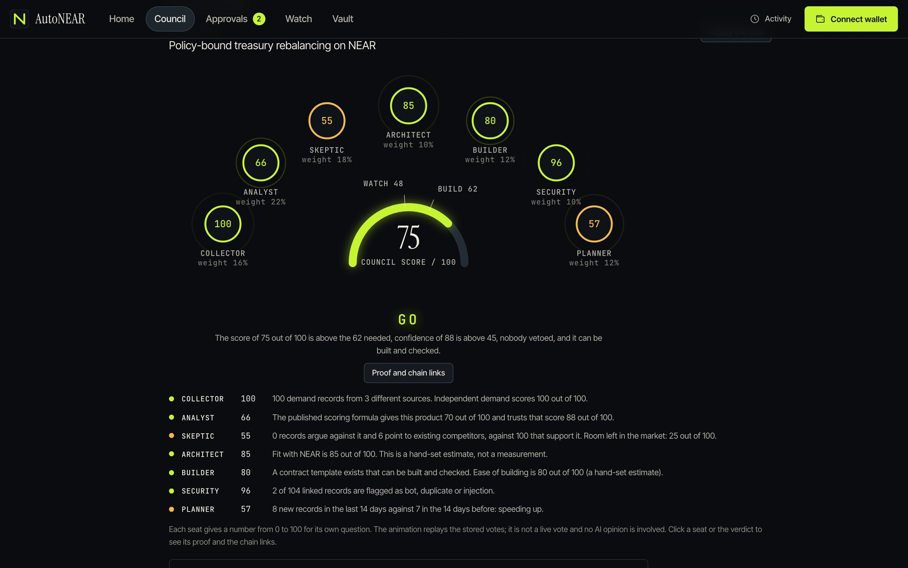
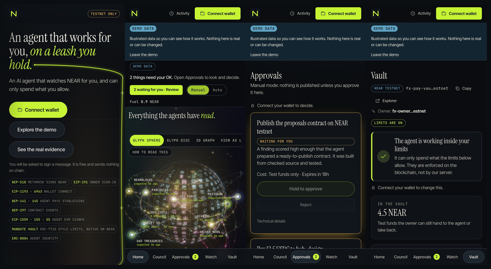
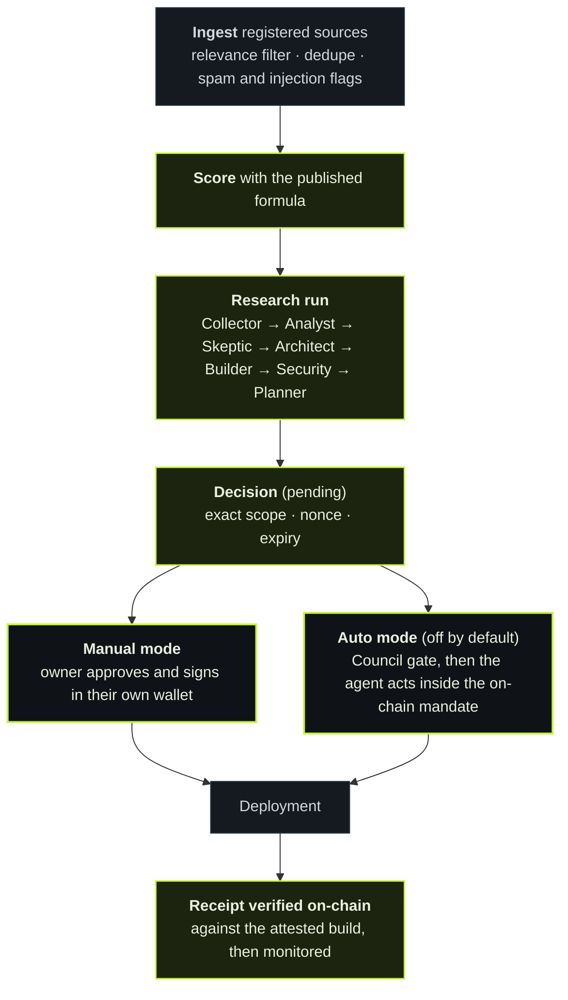
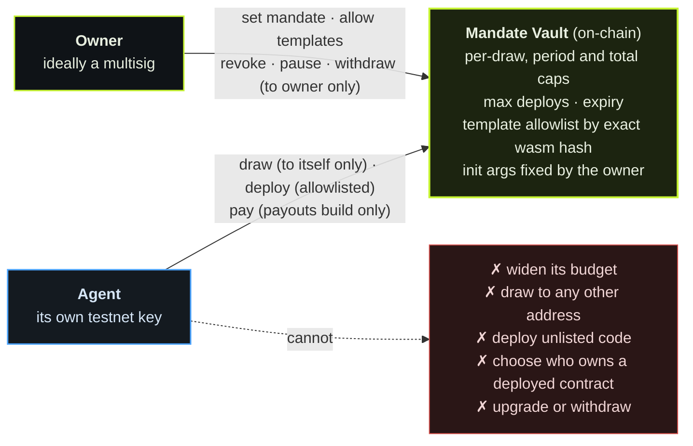
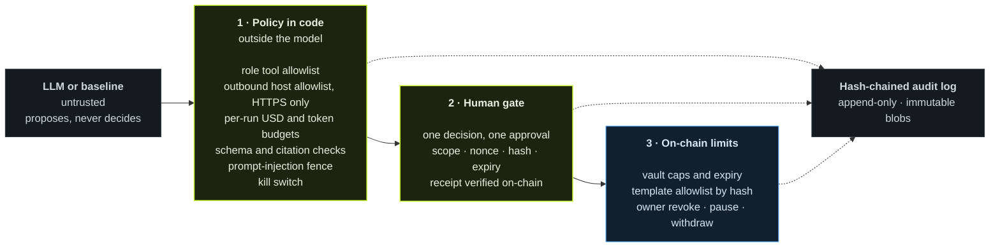

<p align="center">
  
</p>

<p align="center">
  <a href="https://autonear-eight.vercel.app"></a>
  <a href="#quick-start"></a>
  <a href="#how-it-works"></a>
  <a href="#the-mandate-vault"></a>
  <a href="#security"></a>
  <a href="PROGRESS.md"></a>
</p>

AutoNEAR polls public demand and on-chain usage sources for NEAR, scores opportunities with a published formula, has a skeptic role argue against each one, and prepares testnet contract deployments for an owner to approve. An optional agent can draw gas from a vault contract and deploy owner-approved templates through it, inside caps the owner set on-chain. The caps apply to what the agent takes from the vault: NEAR it has already drawn sits in its own account.

Built for the NEAR Hackathon 2026: **Open Innovation** (primary). The vault is also relevant to **AI Security & Defense**. NEAR **testnet only**. MIT.

**What has and has not been demonstrated** (details in [What is real](#what-is-real-and-what-is-not)):

- The default start (`npm start`) runs the app and ingests evidence. It does not deploy a vault or enable the agent signer.
- A public-testnet run exists: vault deployed, mandate set, agent drew gas and deployed an allowlisted registry through the vault ([addresses](#testnet-deployments)). It was signed with **automated demo keys, not by a person**.
- The human-signed path through the Approvals page has **not** been exercised on a public testnet. The mandate on the public vault has been revoked.
- There has been no independent security audit.

<p align="center">
  
</p>

<br>

## Quick start

Requires **Node ≥ 24** (built-in `node:sqlite`). Rust and Foundry are optional, for the contract toolchains.

```bash
git clone https://github.com/johnnyduo/autonear && cd autonear
cp .env.example .env                       # optional: defaults work, no credentials needed to read
npm --prefix web ci && npm --prefix web run build
npm start                                  # http://127.0.0.1:8787  (first tick ingests live data)
```

This starts the local app and ingestion only. Click **Explore the demo** for illustrated data (it can never write) or **See the real evidence** for the stored records. For operator actions, paste the token from `data/operator.token` (created on first start) or your `OPERATOR_TOKEN` into **Operator access** (⌘K).

```bash
npm test                # backend: 699 tests, 696 pass, 3 skipped, 0 fail (local run, 14 Nov 2026)
npm run test:web        # owner-app logic: 159 tests pass (same run)
npm run verify          # all of the above plus Foundry, Rust (registry, vault) and the web build
npm run scan:secrets    # fail on anything that looks like a key or token
```

More checks (`ingest`, `e2e:local`, `test:vault`, `e2e:near-sandbox`) are listed in [PROGRESS.md](PROGRESS.md). Key settings, all documented in [`.env.example`](.env.example): `LLM_PROVIDER` (default `none`, deterministic) · `RUN_BUDGET_USD` / `RUN_BUDGET_TOKENS` (`0.50` / `60000`) · `AUTONOMY_ENABLED` (off) · `COUNCIL_GATE` (on) · `OWNER_ADDRESS` and `PUBLIC_HOSTS` (set both in production) · `NEAR_NETWORK=testnet`.

<br>

## Product tour

<p align="center"></p>

> Screens that need a connected wallet are shown in the app's built-in preview (`#/…?fixture=1`), labelled **DEMO DATA** in the UI: the balances and approvals are fixtures. The evidence constellation and the technical views show records stored by a local run.

**Home.** The evidence constellation, who decides (Manual or Auto), the agent's fuel, and how many requests wait for the owner.



**Council.** Seven rule-based seats score each opportunity from stored data; every reason quotes the numbers it used.



**Approvals.** Each request shows cost, expiry and scope. Press and hold to approve; approval is not execution.


**Vault.** Vault balance, mandate limits, agent fuel, budget used and the owner controls.


**Mobile.** Bottom tab bar and a hold-to-approve control.



<details>
<summary><b>Technical views</b>: constellation, Radar, Security center</summary>
<br>

<sub>The constellation plots stored records by source and topic. Flagged records are marked, not hidden.</sub>
<br><br>

<sub>Radar: each record with its original link, hash, license and why it counts.</sub>
<br><br>

<sub>Security center: role permissions, host allowlists, budgets, the kill switch and audit-chain verification.</sub>
</details>

<br>

## How it works



**Research run.** A typed, budgeted sequence of seven roles. Each stage emits a hash-chained event, stores its output as an immutable blob, and is checked against its role's schema and citation rules before the next stage starts. A failed check sets the run to `blocked`. The Builder and Security Reviewer cannot call an LLM; only the Planner can write a decision. A deterministic baseline runs by default; an LLM (Gemini, Anthropic, Vercel AI Gateway or a local CLI model) is optional and gets the same checks. Only the `treasury` topic currently has an attested contract template, and the build needs a host with the Rust toolchain (the Vercel deployment cannot build).

**Council** ([`src/council.js`](src/council.js)). Seven deterministic rules, one per role, score each stored opportunity. Weights: Analyst 0.22, Skeptic 0.18, Collector 0.16, Builder 0.12, Planner 0.12, Architect 0.10, Security 0.10. **Go** needs weighted support ≥ 0.62, confidence ≥ 0.45, no veto (Skeptic < 0.25 or Security < 0.30) and an attested template for the topic. A high score without a template, or a score ≥ 0.48, returns **watch**; anything else is **drop**. In Manual mode the result is advice shown next to the request. In Auto mode the vault loop acts only on *go* while `COUNCIL_GATE` is on; `COUNCIL_GATE=0` bypasses the check. The rules are hashed so anyone can recompute them.

**Human gate** ([`src/decisions.js`](src/decisions.js)). A decision carries exact scope, nonce, payload hash and an expiry of at most 7 days. Allowed actions are an explicit list: `deploy_testnet`, `grant_mandate`, `pay_testnet`. The server records a deployment only after it verifies the chain receipt: the on-chain code hash equals the attested build, and the signer equals the one bound at approval.

<br>

## The Mandate Vault

An owner can grant the agent a **mandate**: a revocable, capped budget in a vault contract. The NEAR (Rust) and EVM (Solidity, development only) implementations are checked against one shared conformance file, [`contracts/vault-conformance.json`](contracts/vault-conformance.json). The default NEAR build supports `draw` and `deploy`; the optional payouts build (v1.1) adds `pay` for allowlisted tokens and payees.



On NEAR a function-call key cannot deploy a contract, so the vault contract itself creates the sub-account and deploys the code through a promise batch. The sub-account gets no keys, so nobody, including the agent, can redeploy it. The limits cover the vault only: once the agent has drawn NEAR, it sits in the agent's own account, which its key controls, and revoking the mandate does not take it back. Keep caps small. Before signing, the agent's signer allows only the vault's methods, enforces a fee ceiling, re-reads chain state, checks the vault code against the attested build and compares the JavaScript reference model with the chain's own previews. The loop is off by default (`AUTONOMY_ENABLED=1`), needs a Node host you control, and records its decisions and attempted actions in a hash-chained ledger.

### Testnet deployments

All on NEAR testnet, created by [`scripts/e2e-near-testnet.mjs`](scripts/e2e-near-testnet.mjs) and [`scripts/e2e-near-pay-testnet.mjs`](scripts/e2e-near-pay-testnet.mjs). Owner-side transactions were signed by a **demo owner key on the same machine as the agent key**.

| Contract | Account | Notes |
| --- | --- | --- |
| Mandate Vault v1 | [`vault-v1.autonear-owner-1106.testnet`](https://testnet.nearblocks.io/address/vault-v1.autonear-owner-1106.testnet) | Default build. Access keys deleted after deploy. Mandate revoked at the end of the run. |
| Attestation registry | [`reg1.vault-v1.autonear-owner-1106.testnet`](https://testnet.nearblocks.io/address/reg1.vault-v1.autonear-owner-1106.testnet) | Deployed by the agent through the vault; the code hash matched the attested build. |
| Mandate Vault v2 (payouts) | [`vault-v2.autonear-owner-1106.testnet`](https://testnet.nearblocks.io/address/vault-v2.autonear-owner-1106.testnet) | Payouts build with `pay`. The resumed run passed 16 of 16 checks. |
| Mock USDC | [`usdc-v2.autonear-owner-1106.testnet`](https://testnet.nearblocks.io/address/usdc-v2.autonear-owner-1106.testnet) | Test token with an open faucet and no value. |
| Demo owner | [`autonear-owner-1106.testnet`](https://testnet.nearblocks.io/address/autonear-owner-1106.testnet) | Automated key, not a person. |

Selected transactions: [deploy vault](https://testnet.nearblocks.io/txns/migRdhRRshEcvRtCMvmCJoFcKmFgcNAiV6fC6Ux4VFS) · [agent deploys the registry through the vault](https://testnet.nearblocks.io/txns/dza3uxmex1dgQL5gfbR4Qj9vsJPmztgaQLn1u1B9JX1) · [agent pays 10 mock USDC](https://testnet.nearblocks.io/txns/bHqATTBY17QHeHnMnnFgtCBzbe4e4xpZgVeQ3sbvkap) · [refused: draw above the per-draw cap](https://testnet.nearblocks.io/txns/22uZ1m2zWs558XNHAaS1VjpwniWoDnUKnCiaAo1NbjGn). The v1 run lists 14 submitted transactions, four of them deliberate rejections; every hash is in [docs/testnet/near-testnet-v1.json](docs/testnet/near-testnet-v1.json) and [near-pay-testnet-v2.json](docs/testnet/near-pay-testnet-v2.json). The first v2 run had failures (recorded unchanged in the JSON) before the resumed run passed.

<br>

## Sources and scoring

| Tier | Sources | Weight |
| --- | --- | --- |
| **Non-social demand** | GitHub issues (`near` org) · gov.near.org · Hacker News (strict NEAR-Protocol relevance filter) | full |
| **On-chain usage** | NEAR mainnet RPC (Intents escrow) · DefiLlama · NearBlocks · Sputnik DAO treasuries | corroborates only the topic a number measures |
| **Official news** | near.org blog feed | context and competitors, never demand |
| **Social** (unverified) | NEAR Social · Mastodon · Farcaster · Dev.to · Bluesky (opt-in) | **0.4×**, capped together at 0.25× of the non-social weight |

That is 13 registered connectors. Bluesky needs credentials, Farcaster currently returns nothing recent, and any source can return zero records on a given tick. X/Twitter (no free API) and Reddit (not self-serve) are not implemented. Per-source status and errors appear in the ingest result.

`score = Σ weight × component`, served at `GET /api/scoring`: independent demand 0.22 · on-chain corroboration 0.12 · friction severity 0.12 · competition gap 0.12 · NEAR fit 0.12 *(curated prior)* · recency 0.10 · feasibility 0.10 *(curated prior)* · evidence quality 0.10.

Social weight is capped relative to non-social records, so extra social records cannot raise it past the cap; it is zero on a topic with no non-social records, and social sources never count toward the 3-independent-source rule. Records flagged `bot-author`, `low-signal`, duplicate or prompt-injection stay visible, are de-weighted and are kept out of LLM prompts. The 0.4× and the caps are judgements, not measurements ([rationale](src/connectors/source-weights.js)).

<br>

## Security

There has been **no independent security audit**. "Automated checks" means tests, linters, the Security Reviewer role and a model-assisted code review; each finding was fixed or accepted with regression tests, as recorded in [PROGRESS.md](PROGRESS.md). None of these is an audit.



Mainnet, upgrades, treasury spend, liquidity and outreach are blocked in code (`DECISION_LIMITS`). Agent keys are testnet-only, stored with mode `0600` and git-ignored; tests check the known API, log and error paths for key leakage.

**Residual risks, read before enabling Auto:** the vault holds testnet value; a compromised host that can run the agent can spend up to the mandate's caps, and NEAR already drawn stays with the agent after a revoke; the owner should be a multisig; the secp256k1 implementation is not constant-time and keys sit in process memory (not an HSM). Details and threat model: [SECURITY.md](SECURITY.md).

<br>

## What is real, and what is not

[PROGRESS.md](PROGRESS.md) records tests, manual runs and known gaps for the main technical claims.

| Area | Status |
| --- | --- |
| **Evidence pipeline** | Ingest, dedupe, scoring and research runs on a schedule: in-process (local), Vercel Cron or Cloudflare Cron Trigger (deployed). No browser needed. |
| **Hosted app** | Vercel + Turso, configured with a 15-minute cron. Observed Ready on 5 Nov 2026, and manual full ticks returned HTTP 200 in about 65 to 70 s. Scheduled invocations had not yet been confirmed in the logs when PROGRESS.md was last updated. The research run there blocks at the build step (no Rust toolchain). |
| **Autonomy loop** | Node host only, off by default. Run end to end on a local chain and a NEAR sandbox. Not run through the owner-approval path on a public testnet. |
| **Public testnet** | The [runs above](#testnet-deployments), signed by demo keys. The mandate on `vault-v1` is revoked. |
| **Wallet** | The app implements MetaMask signing through NEAR's Ethereum-wallet standard (NEP-518, relayer `eth-rpc.testnet.near.org`, chain id 398). The recorded browser end-to-end tests used a scripted EIP-1193 provider, not a person using MetaMask. |
| **Screens** | The preview screens use fixtures (labelled in the UI). The hosted app shows labelled demo data when no vault exists. |
| **Not done** | Mainnet, upgrades, treasury spend, liquidity, outreach (blocked in code). No independent audit. No MiroFish, Kronos or Pythia runtime (adapters report `not_installed`). The treasury rehearsal uses labelled synthetic fixtures. |

<br>

## Repository and deploy

```text
src/            backend (no runtime dependencies on the Node and Cloudflare paths); one request handler in app.js
contracts/      near-registry (Rust) · near-vault (Rust) · evm (Foundry, off by default) · vault-conformance*.json
web/            React 19 + Vite app and technical views
tests/          backend tests and recorded fixtures      migrations/   SQL schema (SQLite, D1, libSQL)
scripts/        attestation, e2e and onboarding scripts  docs/         deploy guides, screenshots, testnet records
video/          Remotion pipeline for the demo video     PROGRESS.md   claims, status and proof commands
```

| Target | Notes | Guide |
| --- | --- | --- |
| **Vercel + Turso** | Git-connected, 15-minute cron. Pin the function region to your Turso region (a mismatch caused HTTP 504). | [DEPLOY-VERCEL.md](docs/DEPLOY-VERCEL.md) |
| **Cloudflare Workers + D1** | Same handler. The deploy guide records the Free plan as 10 ms CPU and 50 D1 queries per invocation, which cannot finish a full tick; confirm current limits with Cloudflare. | [DEPLOY-CLOUDFLARE.md](docs/DEPLOY-CLOUDFLARE.md) |
| **Any small host** | `npm start`. The only target that runs the autonomy loop and the Rust and Foundry build attestations. | [Quick start](#quick-start) |

In Manual mode a contract is deployed only after the owner approves and signs. Upstream engines named in the Engine Registry keep their own licenses (MiroFish is AGPL-3.0: isolate it as a separate service if ever enabled). License: MIT.
