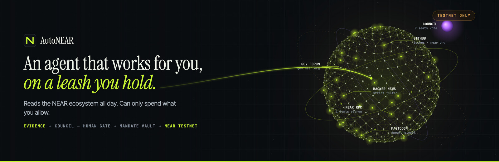
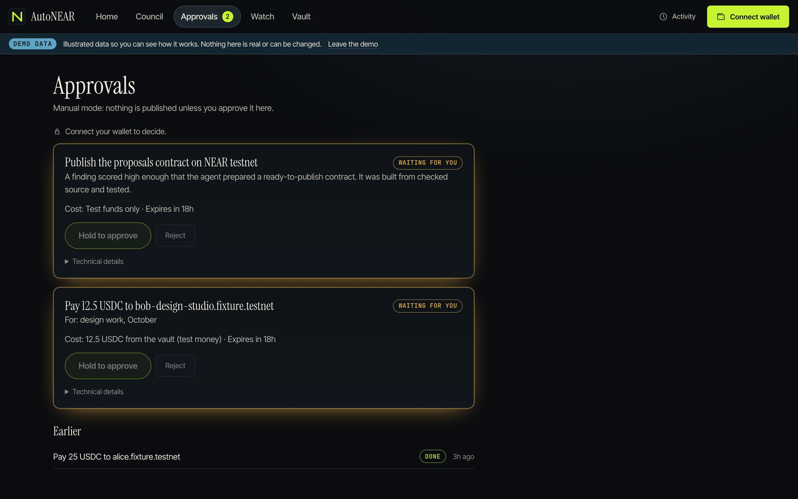
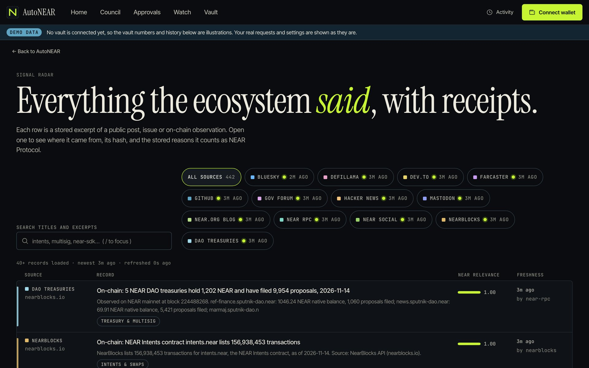
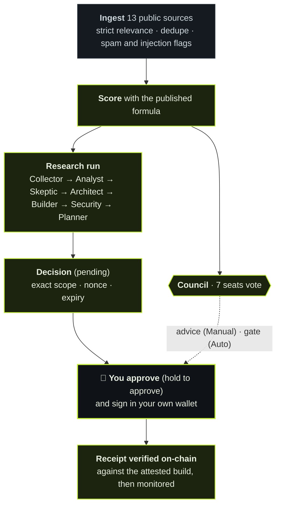
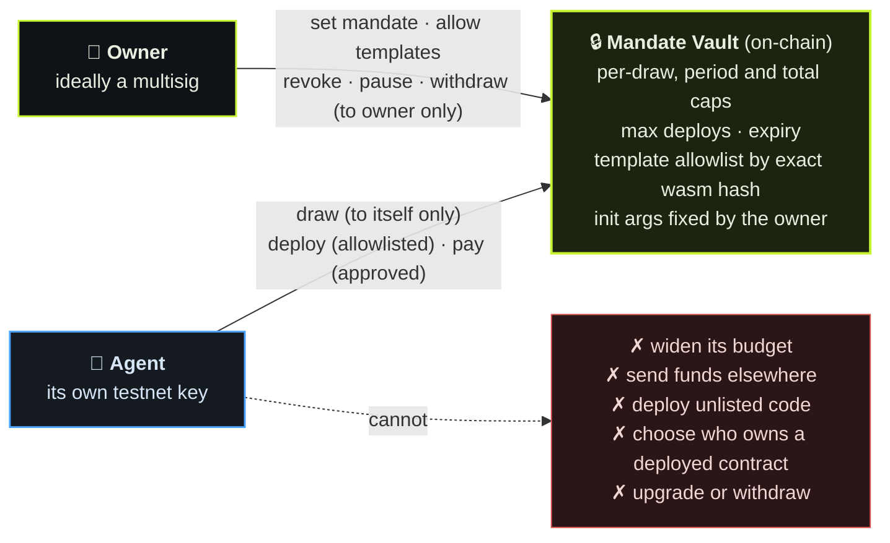

<p align="center">
  
</p>

<p align="center">
  <a href="https://autonear-eight.vercel.app"></a>
  <a href="#quick-start"></a>
  <a href="#how-it-works"></a>
  <a href="#the-mandate-vault"></a>
  <a href="#security"></a>
  <a href="PROGRESS.md"></a>
</p>

<p align="center">
  <b>An evidence-to-product operating system for NEAR.</b><br>
  It watches public demand and on-chain usage, scores opportunities with a published formula, lets a skeptic try to break every thesis,<br>
  builds an attested contract, and asks one human for one scoped decision at a time.
</p>

<p align="center">
  
</p>

<p align="center"><sub>NEAR Hackathon 2026 · track <b>AI Security &amp; Defense</b> · NEAR <b>testnet only</b> · MIT</sub></p>

<br>

## What it is

Most "AI agents for crypto" ask you to trust a prompt. AutoNEAR does not. The agent is **useful** (it reads the ecosystem all day and tells you what is worth building) and **boxed in** (everything that could cost you money is enforced by a contract or by code *outside* the model).

<p align="center"></p>

<br>

## Product tour

> Screens that need a connected wallet are shown in the app's built-in preview (`#/…?fixture=1`), labelled **DEMO DATA** in the UI: illustrated balances and approvals, nothing real. The evidence constellation and the technical screens show real stored data from a local run (442 records from 13 sources on 14 Nov 2026).

**Home.** What the agents read, who decides (Manual or Auto), the agent's fuel, and how many things need your OK.


**Council.** Seven seats vote on every opportunity from stored data; every reason quotes the numbers it used.


**Approvals.** One decision, one signature. Press-and-hold to approve; approval is not execution.



**Vault.** Contract state in plain words: what is in the vault, the agent's fuel, the budget used, and one explained row per emergency control.


**Phone-first.** Bottom tab bar, thumb-sized hold-to-approve, no horizontal scroll.


<details>
<summary><b>The technical room</b> (real stored data, one click from Activity): constellation, Radar, Security center</summary>
<br>

<sub>Every stored record as a point of light, grouped by source and topic. Flagged records are visible, not hidden.</sub>
<br><br>

<sub>Radar: every record with its original link, hash, license and why it counts (or does not).</sub>
<br><br>

<sub>Security center: role permissions, host allowlists, budgets, the kill switch and audit-chain verification.</sub>
</details>

<br>

## How it works



**Research run.** A typed, budgeted sequence of seven roles. Each stage emits a hash-chained event, stores its output as an immutable blob, and passes a schema and citation check before the next may start; a failed check discards the output and the run is `blocked`, not guessed. The Builder and Security Reviewer cannot call an LLM at all; only the Planner can write a decision. A deterministic baseline runs by default; an LLM (Gemini, Anthropic, Vercel AI Gateway or local Codex CLI) is optional and gets the same checks.

**Council** ([`src/council.js`](src/council.js)). Each seat is a pure function of stored data, weighted: Analyst 0.22, Skeptic 0.18, Collector 0.16, Builder 0.12, Planner 0.12, Architect 0.10, Security 0.10. **Go** needs weighted support ≥ 0.62, confidence ≥ 0.45, no veto (Skeptic < 0.25 or Security < 0.30) *and* an attested build template for the topic; ≥ 0.48 is **watch** (including "a trend we see and cannot ship yet"); anything else is **drop**. In Manual mode it is advice; in Auto mode the vault loop acts only on *go* (`COUNCIL_GATE=0` is the operator's off switch). The rules are hashed so anyone can recompute them.

**Human gate** ([`src/decisions.js`](src/decisions.js)). One decision, one approval, exact scope, nonce, payload hash and expiry (at most 7 days). Allowed actions are an explicit list: `deploy_testnet`, `grant_mandate`, `pay_testnet`. The server records a deployment only after it verifies the chain receipt: the on-chain code hash equals the attested build, and the signer equals the one bound at approval.

<br>

## The Mandate Vault

Beyond one-decision-one-signature, an owner can grant the agent a **mandate**: a revocable, capped budget in a vault contract. One state machine, two native implementations (NEAR Rust, EVM Solidity kept for development), checked against **one shared conformance file** ([`contracts/vault-conformance.json`](contracts/vault-conformance.json)).



On NEAR a function-call key cannot deploy a contract, so the **vault contract itself** creates the sub-account and deploys the code through a promise batch, with **no keys** on the sub-account: nobody, including the agent, can redeploy it. Off-chain defense in depth: the signer refuses any target or method except the vault's `draw`, `deploy` and `pay`, refuses calls above a fee ceiling, re-reads chain state, checks the vault code against the attested build and compares the JavaScript reference model with the chain's own previews before signing. The loop is **off by default** (`AUTONOMY_ENABLED=1`), runs only on a Node host you control, and logs every action to a hash-chained ledger.

Spec and error codes: [docs/agent-vault-spec.md](docs/agent-vault-spec.md) · real agent-signed testnet transactions with explorer links: [docs/testnet/near-testnet-v1.json](docs/testnet/near-testnet-v1.json).

<br>

## Evidence and scoring

| Tier | Sources | Weight |
| --- | --- | --- |
| **Core demand** | GitHub issues (`near` org) · gov.near.org · Hacker News (strict NEAR-Protocol relevance filter) | full |
| **On-chain usage** | NEAR mainnet RPC (Intents escrow) · DefiLlama · NearBlocks · Sputnik DAO treasuries | corroborates only the topic a number actually measures |
| **Official news** | near.org blog feed | context and competitors, never demand |
| **Social** (free, unverified) | NEAR Social · Mastodon · Farcaster · Dev.to · Bluesky (opt-in) | **0.4×**, capped together at 0.25× of the core weight |

X/Twitter (no free API) and Reddit (not self-serve) are intentionally absent. Source errors are shown, never papered over.

`score = Σ weight × component`, served at `GET /api/scoring` and decomposed on screen: independent demand 0.22 · on-chain corroboration 0.12 · friction severity 0.12 · competition gap 0.12 · NEAR fit 0.12 *(curated prior)* · recency 0.10 · feasibility 0.10 *(curated prior)* · evidence quality 0.10.

Social evidence is deliberately hard to game: 200 spam accounts change nothing beyond the cap, social carries **zero** weight on a topic with no core records, and social sources never count toward the 3-independent-source rule. Records flagged `bot-author`, `low-signal`, duplicate or prompt-injection stay visible but de-weighted and are quarantined from LLM prompts. The 0.4× and the caps are judgements, not measurements ([rationale](src/connectors/source-weights.js)).

<br>

## Security

AutoNEAR is a hackathon MVP with **no independent security audit**. "Automated checks" means tests, linters, a mechanical Security Reviewer role and an AI-assisted code review archived with every finding's resolution in [docs/audit/](docs/audit/). None of these is an audit.


Mainnet, upgrades, treasury spend, liquidity and outreach are blocked in code (`DECISION_LIMITS`). Keys are testnet-only, mode `0600`, git-ignored and never returned by the API, logs or errors (a test greps for them).

**Residual risks, read before enabling Auto:** the vault holds real testnet value; a compromised host that can run the agent can spend up to the mandate's caps; the owner should be a multisig; the secp256k1 implementation is not constant-time and keys sit in process memory (not an HSM). Full detail and threat model: [SECURITY.md](SECURITY.md) · [docs/INCIDENT-RUNBOOK.md](docs/INCIDENT-RUNBOOK.md).

<br>

## What is real, and what is not

Every claim has a re-runnable proof command in [PROGRESS.md](PROGRESS.md).

| Area | Status |
| --- | --- |
| **Live sources** | 13 sources ingested on a schedule, with per-source status and errors. Farcaster currently returns nothing recent; Bluesky is opt-in. |
| **Unattended** | In-process scheduler (local), Vercel Cron or Cloudflare Cron Trigger (deployed): ingest, dedupe, re-score, recover stalled runs. No browser needed. |
| **Production** | Vercel + Turso, cron every 15 minutes. A full tick returned HTTP 200 in about 65 to 70 s when measured on 5 Nov 2026. |
| **Network** | NEAR **testnet only**. Owners sign with MetaMask through NEAR's Ethereum-wallet standard (NEP-518): a `0x…` address is a NEAR implicit account. |
| **Testnet transactions** | **14 real transactions**: vault deployed, mandate set, agent drew gas, agent deployed an allowlisted registry through the vault ([records](docs/testnet/near-testnet-v1.json)). The owner-side ones were signed by a **demo owner key on the same machine as the agent key: automation, not a human signature.** The human-signed path through Approvals has **not** been exercised on a public testnet. |
| **Not done** | Mainnet, upgrades, treasury spend, liquidity, outreach (blocked in code). No independent audit. No MiroFish, Kronos or Pythia runtime (adapters report `not_installed`). The treasury rehearsal uses **labelled synthetic fixtures**. |

<br>

## Quick start

Requires **Node ≥ 24** (built-in `node:sqlite`). Rust and Foundry are optional, for the contract toolchains.

```bash
git clone https://github.com/johnnyduo/autonear && cd autonear
cp .env.example .env                       # optional: defaults work, no credentials needed to read
npm --prefix web ci && npm --prefix web run build
npm start                                  # http://127.0.0.1:8787  (first tick ingests live data)
```

Click **Explore the demo** for illustrated data (can never write) or **See the real evidence** for the constellation. For operator actions, paste `data/operator.token` into **Operator access** (⌘K). Wallets connect through MetaMask on NEAR testnet (relayer `eth-rpc.testnet.near.org`, chain id 398).

```bash
npm run verify          # syntax + backend + Foundry + Rust (registry, vault) + web build
npm test                # backend: 697 tests (694 pass, 3 skipped, 0 fail on 14 Nov 2026)
npm run test:web        # owner-app logic: 151 tests
npm run ingest          # real network ingestion, per-source results
npm run e2e:local       # full loop on a LOCAL chain: ingest, run, approve, deploy, on-chain verify
npm run test:vault      # vault model, conformance, service and autonomy loop
npm run scan:secrets    # fail on anything that looks like a key or token
```

Key settings (all documented in [`.env.example`](.env.example)): `LLM_PROVIDER` (default `none`, deterministic) · `RUN_BUDGET_USD` / `RUN_BUDGET_TOKENS` (`0.50` / `60000`) · `AUTONOMY_ENABLED` (off) · `COUNCIL_GATE` (on) · `OPERATOR_TOKEN` · `OWNER_ADDRESS` and `PUBLIC_HOSTS` (set both in production) · `NEAR_NETWORK=testnet`.

<br>

## Repository map and deploy

```text
src/            backend, no runtime dependencies on the Node and Cloudflare paths; one Web-standard handler (app.js)
  connectors/   one file per source        orchestrator/  coordinator + seven role agents
  policy.js     allowlists, budgets, DECISION_LIMITS      council.js · scoring.js · decisions.js
  autonomy.js   the vault loop (off by default)           vault/ · agent/   vault adapters, the agent's signer
contracts/      near-registry (Rust) · near-vault (Rust) · evm (Foundry, off by default) · vault-conformance*.json
web/            React 19 + Vite owner app and technical room        tests/ · migrations/ · docs/
video/          Remotion + Gemini TTS demo-video pipeline           PROGRESS.md   every claim and its proof
```

| Target | Notes | Guide |
| --- | --- | --- |
| **Vercel + Turso** *(production)* | Git-connected, 15-minute cron. Pin the function region to your Turso region (a mismatch caused HTTP 504). | [DEPLOY-VERCEL.md](docs/DEPLOY-VERCEL.md) |
| **Cloudflare Workers + D1** | Same handler. The Workers *Free* plan (10 ms CPU, 50 D1 queries) **cannot** finish a full tick: use Workers Paid. | [DEPLOY-CLOUDFLARE.md](docs/DEPLOY-CLOUDFLARE.md) |
| **Any small host** | `npm start`. The only target that runs the autonomy loop and the Rust and Foundry build attestations. | [Quick start](#quick-start) |

Contract deployment is always a human act: see the Approvals page and `scripts/near-deploy.sh`.

<br>

**More:** [PROGRESS.md](PROGRESS.md) (claims and proofs) · [SECURITY.md](SECURITY.md) · [Vault spec](docs/agent-vault-spec.md) · [Registry spec](docs/contracts-spec.md) · [Audit archive](docs/audit/) · [Testnet records](docs/testnet/) · [Video pipeline](video/README.md)

**License:** MIT. Upstream engines named in the Engine Registry keep their own licenses (MiroFish is AGPL-3.0: isolate it as a separate service if ever enabled).
