<div align="center">

# AutoNEAR

### An agent that works for you, on a leash you hold.

**An evidence-to-product operating system for NEAR.**<br>
It watches public demand and on-chain usage, scores opportunities with a published formula, lets a skeptic try to break every thesis, builds an attested contract, and asks one human for one scoped decision at a time.

<br>


[Live app](https://autonear-eight.vercel.app) · [Quick start](#quick-start) · [How it works](#how-it-works) · [Mandate Vault](#the-mandate-vault-the-leash) · [Security](#security-model) · [Proof table](PROGRESS.md)

<br>

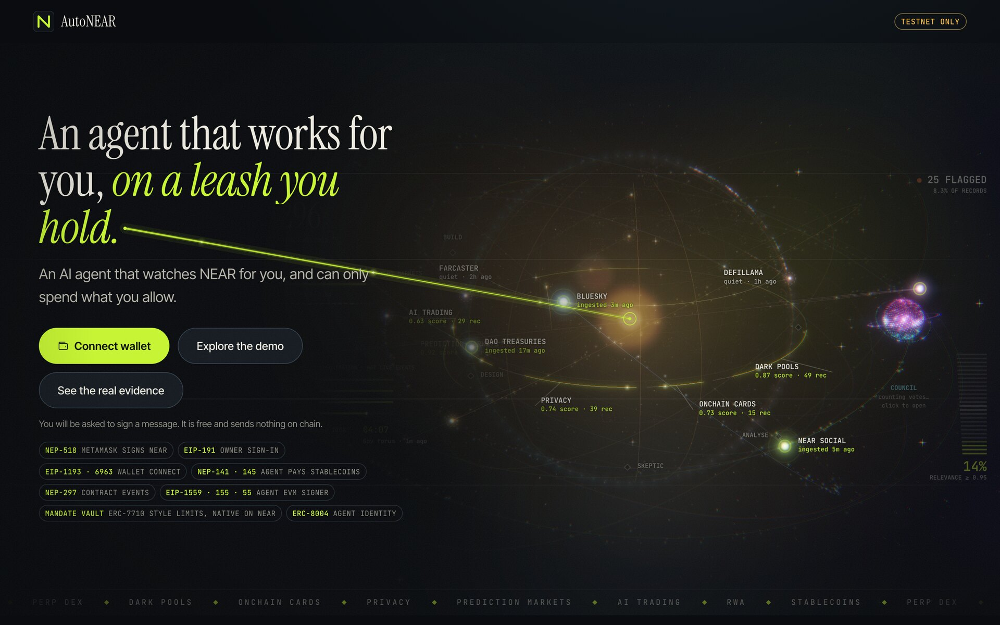

<sub>The landing page. The sphere is real data: every glyph is a stored public record (GitHub, the NEAR governance forum, Hacker News, NEAR mainnet RPC, Mastodon, Bluesky and more). Captured from a local run on 14 Nov 2026.</sub>

</div>

<br>

## Contents

1. [What it is, in one minute](#what-it-is-in-one-minute)
2. [Product tour](#product-tour)
3. [How it works](#how-it-works) — pipeline, council, human gate
4. [The Mandate Vault (the leash)](#the-mandate-vault-the-leash)
5. [Evidence and scoring](#evidence-and-scoring)
6. [Security model](#security-model)
7. [What is real, and what is not](#what-is-real-and-what-is-not)
8. [Quick start](#quick-start) · [Verify it yourself](#verify-it-yourself) · [Configuration](#configuration)
9. [Architecture and repository map](#architecture-and-repository-map)
10. [Deploy](#deploy)
11. [Documentation index](#documentation-index) · [License](#license)

<br>

## What it is, in one minute

Most "AI agents for crypto" ask you to trust a prompt. AutoNEAR does not. The agent is **useful** (it reads the ecosystem all day and tells you what is worth building) and **boxed in** (everything that could cost you money is a rule enforced by a contract or by code *outside* the model).

| Question | Answer |
| --- | --- |
| **What does the agent do all day?** | Ingests 13 public sources every 15 minutes, dedupes and de-spams them, re-scores seven product opportunities, and starts a research run when something material changed. |
| **Who decides what gets built?** | A seven-seat **Council** votes on every opportunity by published rules (no LLM opinion). The *owner* decides what is shipped: **Manual** (the default) waits for you, **Auto** acts only inside limits you set on-chain. |
| **What can the agent spend?** | Only what you put in a **Mandate Vault** contract, only inside a per-draw, per-period and total cap, only to itself, only for code you pre-approved by exact hash. You can revoke, pause or withdraw at any time. |
| **What if the AI is wrong or hacked?** | Policy is code outside the LLM: role tool allowlists, host allowlists, budgets, schema and citation validation, a kill switch, and a hash-chained audit log. Worst case is bounded by your mandate. |
| **Where does it run?** | NEAR **testnet only**. Mainnet is blocked in code. Wallets are MetaMask-style (EVM) through NEAR's Ethereum-wallet standard, NEP-518. |

```mermaid
flowchart LR
    classDef who fill:#0f1317,stroke:#c6f432,color:#e8efe0,stroke-width:1.5px
    classDef box fill:#141a20,stroke:#2b3640,color:#cfd8dc
    classDef lock fill:#1c2410,stroke:#c6f432,color:#e8efe0,stroke-width:2px

    W["🌐 Public world<br/>GitHub · gov forum · HN<br/>NEAR RPC · social"]:::box
    A["🤖 AutoNEAR agents<br/>read · score · doubt · build"]:::box
    C{{"🗳 Council<br/>published rules"}}:::box
    H["👤 You<br/>hold the leash"]:::who
    V[("🔒 Mandate Vault<br/>caps · expiry · revoke")]:::lock
    N["⛓ NEAR testnet<br/>attested contract"]:::box

    W -->|evidence| A -->|opportunities| C
    C -->|advice or go| H
    H -->|signs a mandate| V
    A -.->|may only draw gas and deploy allowlisted code| V
    V -->|bounded spend| N
    H -->|revoke · pause · withdraw, any time| V
```

<br>

## Product tour

> **Reading the screenshots.** Pages that need a connected wallet are shown in the app's built-in **preview** (`#/…?fixture=1`), which is clearly labelled **DEMO DATA** in the UI: illustrated vault balances, approvals and payments so you can see every state without a wallet. The landing page, the evidence constellation and the technical screens show **real stored data** from a live local run (442 evidence records from 13 sources on the day of capture). Nothing in a screenshot is a real payment.

### 1 · Landing: understand it in five seconds

The first screen says what the product is, offers three honest paths (**Connect wallet** · **Explore the demo** · **See the real evidence**) and states the one thing that matters: *signing in is free and sends nothing on chain.*

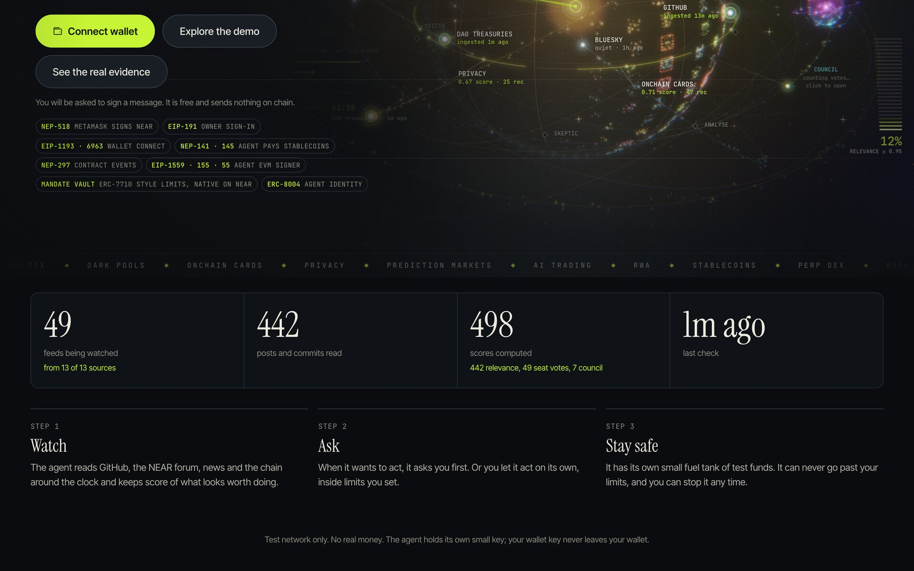

### 2 · Home: what the agents read, and what needs you

Home is the evidence constellation plus one decision strip: **who decides** (Manual or Auto), **agent fuel**, and **how many things need your OK**.


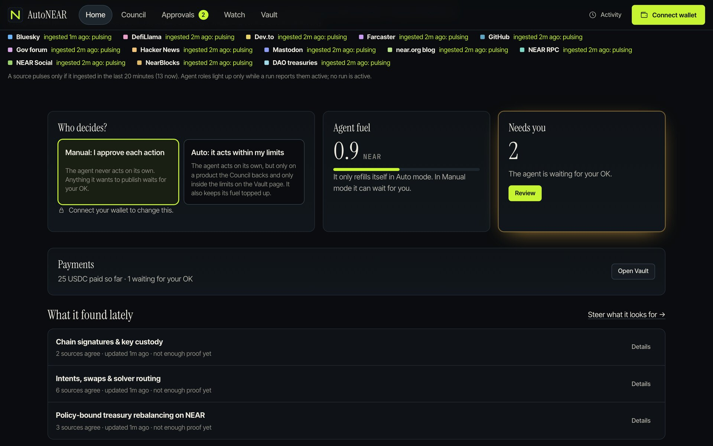

| Manual (default) | Auto |
| --- | --- |
| Nothing is published or paid unless you approve it. The Council is advice shown next to each request. | The agent may act on its own, **only** when the Council says *go*, **only** inside the vault limits you signed on-chain. |

### 3 · Council: the decision layer

Seven seats vote on every opportunity from stored data. Every reason string quotes the numbers it used. No seat is an LLM opinion.

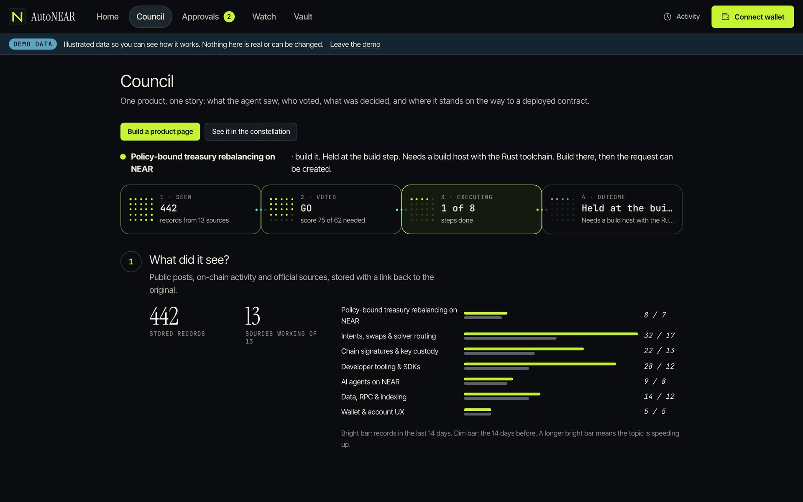


### 4 · Approvals: one decision, one signature

Each request shows its cost, its expiry and exactly what it will do. Approving is a **press-and-hold** (no accidental clicks). Approval is **not** execution: the server only records a deployment after it has verified the chain receipt.


### 5 · Vault: the leash, made visible

The Vault page turns contract state into plain words: *"The agent is working inside your limits."* It shows what is in the vault, the agent's fuel, how much of the budget is used, and one explained row per emergency control.

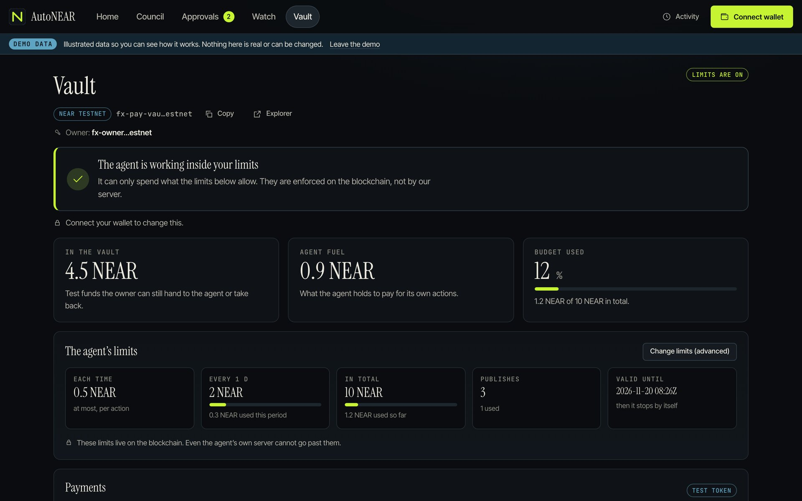

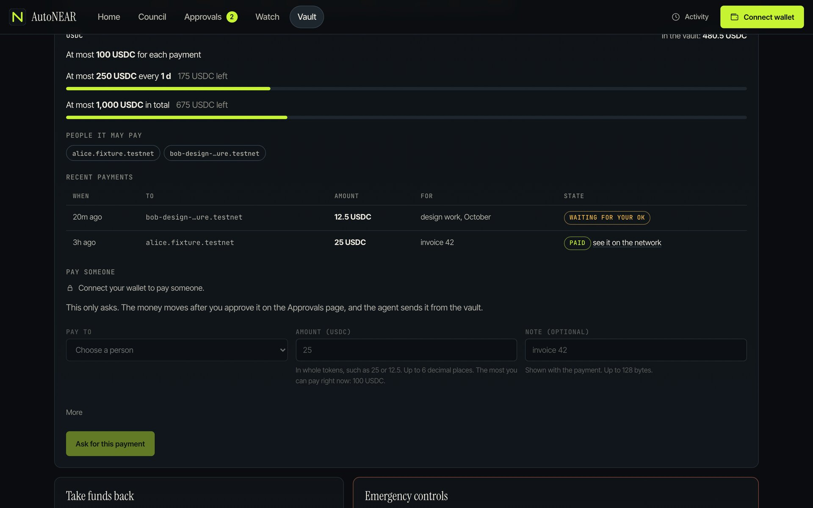

### 6 · Watch: steer what the agent hunts

Owners can add keywords and hackathons to boost, phrases to exclude, and switch sources on or off. A keyword can only **tighten or rank** what the relevance rule already accepts. It never makes a record "NEAR" and never clears a spam or injection flag.

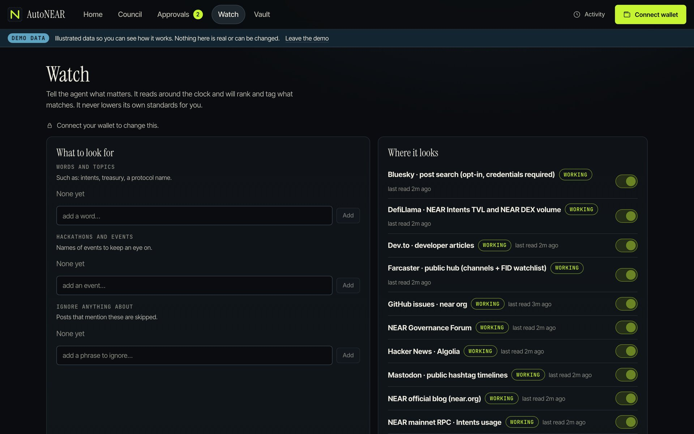

### 7 · Build: from finding to a verified contract

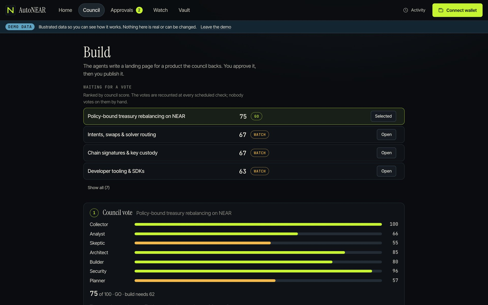

### 8 · Mobile

The whole owner app is designed phone-first: a bottom bar with five tabs, hold-to-approve that works with a thumb, and no horizontal scroll.


### 9 · The technical room (everything the owner app summarises)

The plain-language app sits on top of full technical screens, one click away from **Activity**. These show real stored data.

<table>
<tr>
<td width="50%"><b>Evidence constellation</b><br><sub>Every stored record as a point of light, grouped by source and topic; flagged records are visible, not hidden.</sub><br>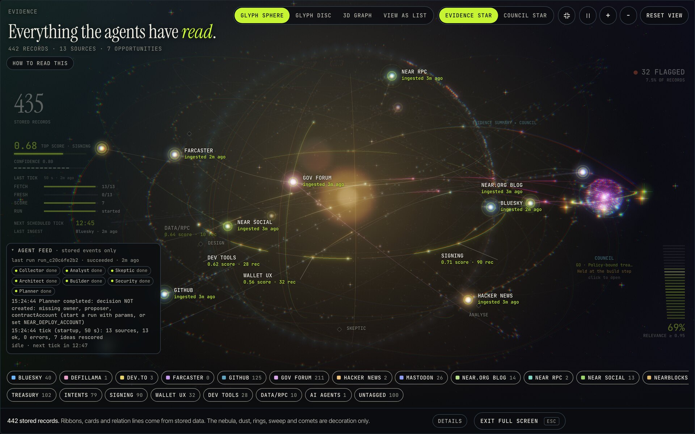</td>
<td width="50%"><b>Technical overview</b><br><sub>"AutoNEAR is live": sources, records, opportunities, runs, and the constellation panel.</sub><br>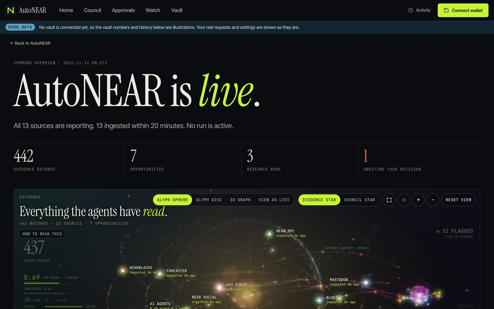</td>
</tr>
<tr>
<td width="50%"><b>Radar</b><br><sub>Every record with its original link, hash, license and why it counts (or does not).</sub><br></td>
<td width="50%"><b>Studio</b><br><sub>The cited product brief, the skeptic's findings and the automated check results.</sub><br>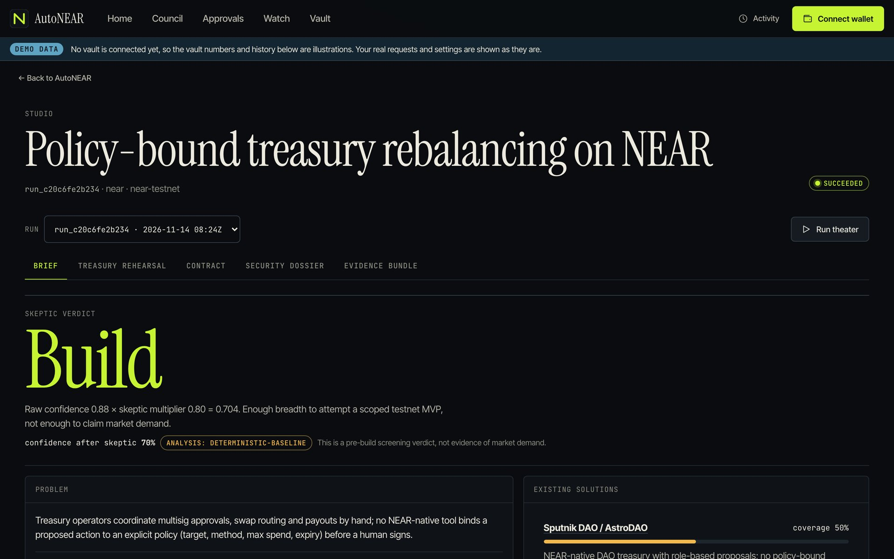</td>
</tr>
<tr>
<td width="50%"><b>Security center</b><br><sub>Role permissions, host allowlists, budgets, the kill switch and audit-chain verification.</sub><br>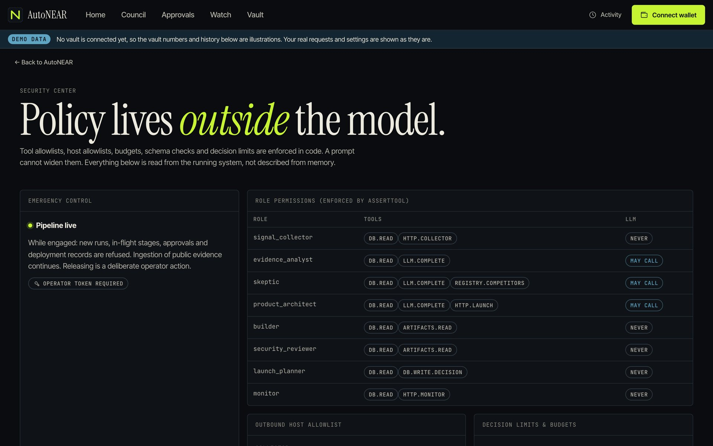</td>
<td width="50%"><b>Engine registry</b><br><sub>Optional engines (Pythia, MiroFish, Kronos) reported honestly: not installed, and why.</sub><br>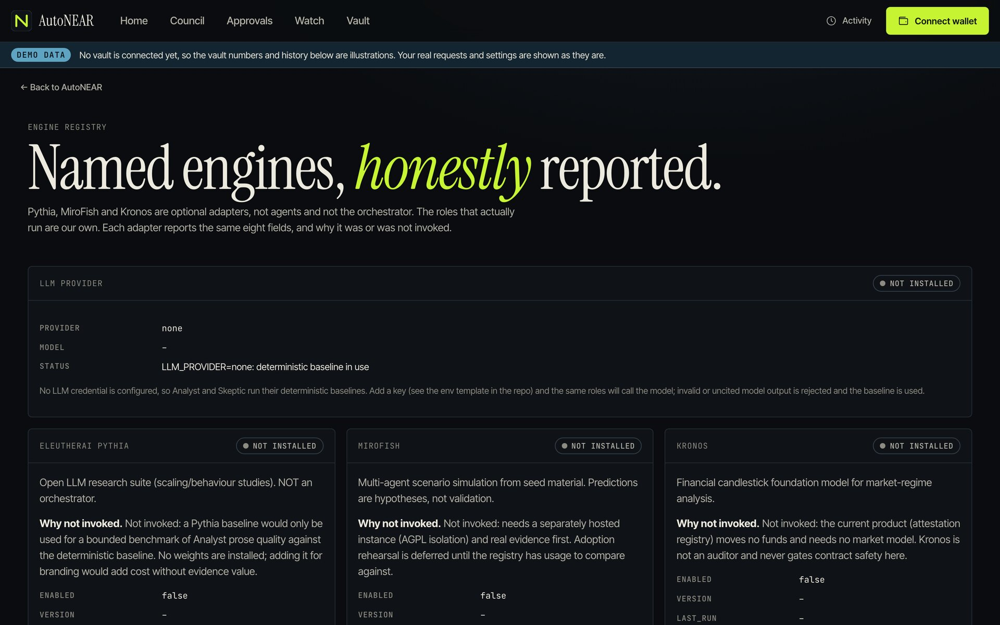</td>
</tr>
</table>

<br>

## How it works

### The research pipeline

A *run* is a typed, budgeted sequence of seven roles. Every stage emits a **hash-chained event**, stores its output as an **immutable blob**, and is checked against a schema and a citation guard before the next stage may start. If any check fails, the stage output is discarded and the run is `blocked`, not guessed.

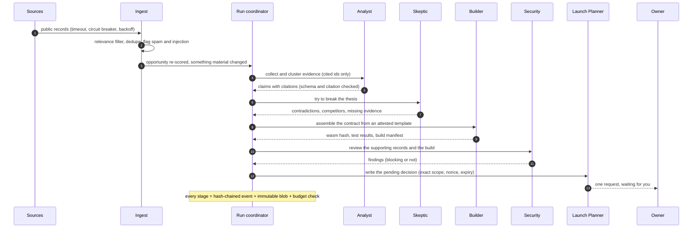

Roles are least-privilege by construction. The Builder and Security Reviewer cannot call an LLM at all; only the Launch Planner can write a decision; each role has its own outbound host allowlist. A deterministic baseline runs by default. An LLM (Gemini, Anthropic, Vercel AI Gateway, or a local Codex CLI) can be switched on, and its output is accepted only if it passes the same schema and citation checks.

### The Council

The Council is the layer between *"we scored it"* and *"the agent may act"*. It lives in [`src/council.js`](src/council.js) and its rules are hashed, so anyone with the source can recompute the rules hash and see when a rule changed.

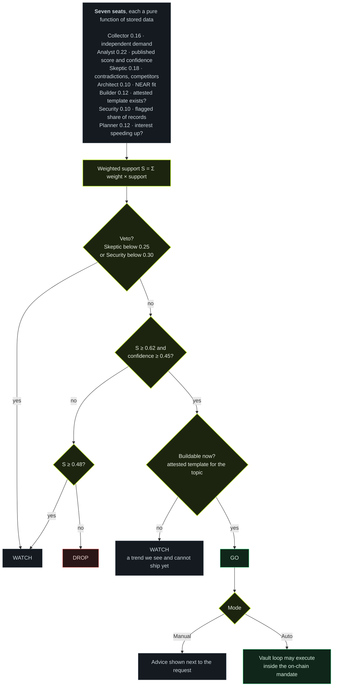

`COUNCIL_GATE=0` is the operator's off switch. Thresholds and weights are judgements, labelled as such in the code, not measurements.

### The human gate

One decision is one approval, with exact scope, nonce and expiry. Approving is **not** executing, and the server never takes the human's word for a deployment: it verifies the receipt on-chain against the attested artifact and against the signer that was bound at approval time.

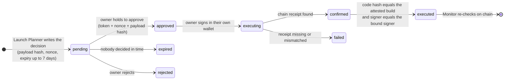

Allowed actions are an explicit list in code (`deploy_testnet`, `grant_mandate`, `pay_testnet`). Upgrades, liquidity and outreach are separate decision types that are not enabled, and mainnet is rejected before a decision can even be created.

<br>

## The Mandate Vault (the leash)

Beyond the one-decision-one-signature flow, an owner can grant the agent a **mandate**: a revocable, capped budget held in a vault contract. The vault exists on NEAR (Rust, `near-sdk`) and on EVM (Solidity, kept for development), as **one state machine with one shared conformance file** (`contracts/vault-conformance.json`) that both implementations and a JavaScript reference model must satisfy.

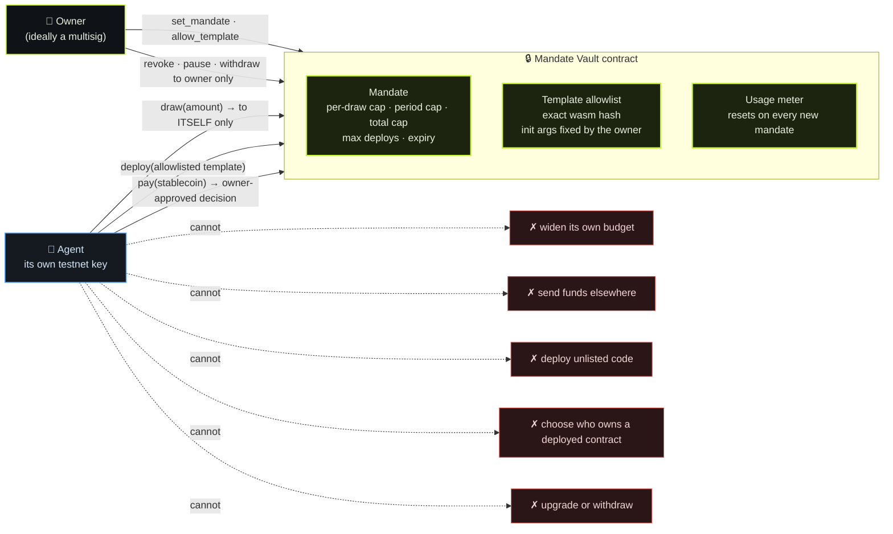

**What the agent can never do:** change config, widen its budget, send funds anywhere else, deploy code you did not allowlist by hash, pick init arguments (so it cannot choose who owns a contract it deploys), upgrade, or withdraw.
**What you can always do:** revoke, pause, withdraw (to your own address only), replace the mandate. Your funds are never trapped.

On NEAR, a function-call key cannot deploy a contract, so the **vault contract itself** creates the sub-account and deploys the code through a promise batch. The sub-account is created with **no keys**: nobody, including the agent, can redeploy it.

Defense in depth, off-chain: the signer refuses any target or method except the vault's `draw`, `deploy` and `pay`, refuses any call above a fee ceiling, re-reads chain state before acting, checks the vault code against the attested build, and compares the JavaScript reference model with the chain's own previews before it signs. The loop is **off by default** (`AUTONOMY_ENABLED=1`), runs only on a Node host you control, and every action lands in a hash-chained ledger.

> Full spec and error codes: [docs/agent-vault-spec.md](docs/agent-vault-spec.md) · proof table: Gate G in [PROGRESS.md](PROGRESS.md) · real testnet transactions (agent-signed, with explorer links): [docs/testnet/near-testnet-v1.json](docs/testnet/near-testnet-v1.json).

<br>

## Evidence and scoring

### Sources

| Tier | Sources | Weight |
| --- | --- | --- |
| **Core demand** | GitHub issues in the `near` org · NEAR governance forum (gov.near.org) · Hacker News (strict NEAR-Protocol relevance filter) | full |
| **On-chain usage** | NEAR mainnet RPC (Intents escrow) · DefiLlama · NearBlocks · Sputnik DAO treasuries | corroborates only the topic a number actually measures |
| **Official news** | near.org blog feed | context and competitor signal, never demand |
| **Social** (free, unverified) | NEAR Social (`social.near`) · Mastodon hashtags · Farcaster · Dev.to · Bluesky (opt-in) | **0.4×**, and capped in aggregate at 0.25× of the core weight |

X/Twitter (no free API tier) and Reddit (not self-serve) are **intentionally absent**. Source errors are shown, never papered over.

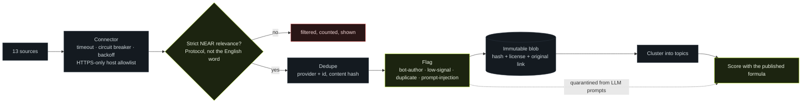

### The published formula

`score = Σ weight × component`. The formula and every component are served at `GET /api/scoring` and decomposed on screen, so nothing about a score is hidden.

| Component | Weight | Component | Weight |
| --- | ---: | --- | ---: |
| Independent demand | 0.22 | Competition gap | 0.12 |
| On-chain corroboration | 0.12 | NEAR fit *(curated prior)* | 0.12 |
| Friction severity | 0.12 | Feasibility *(curated prior)* | 0.10 |
| Recency | 0.10 | Evidence quality | 0.10 |

**Social evidence is deliberately hard to game.** All social records of a topic *together* are capped at 0.25× the core weight in every weighted mean, in the breadth counts and in confidence, so 200 spam accounts change nothing beyond the cap, and social carries **zero** weight on a topic with no core records. At most 3 effective authors and 1 effective source can come from social, and social sources **never** count toward the 3-independent-source rule. The `LOW CONFIDENCE` warning counts non-social sources. The 0.4× and the caps are judgements, not measurements (rationale in [`src/connectors/source-weights.js`](src/connectors/source-weights.js)). No social record is presented as verified fact.

<br>

## Security model

AutoNEAR is a hackathon MVP with **no independent security audit**. "Automated checks" means exactly that: tests, linters, a mechanical review by the Security Reviewer role, and an AI-assisted code review archived with every finding's resolution in [docs/audit/](docs/audit/). None of these is an audit.

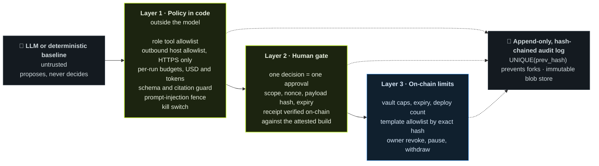

| Control | Where | Enforced by |
| --- | --- | --- |
| Role tool allowlist (e.g. Builder cannot call an LLM) | `ROLE_POLICY`, `assertTool` in [`src/policy.js`](src/policy.js) | code |
| Outbound host allowlist per role | `ALLOWED_HOSTS`, `guardedFetch` | code |
| Run budgets (USD, tokens), charged before the next stage | coordinator | code |
| Schema and citation validation of every agent output | orchestrator | code |
| Mainnet, upgrades, treasury spend, liquidity, outreach | `DECISION_LIMITS` | code (blocked) |
| Spend caps, expiry, deploy count, pause, revoke | vault contract | **chain** |
| Deploy only allowlisted code hash, owner-fixed init args | vault contract | **chain** |
| Key custody: testnet keys only, mode `0600`, git-ignored, never in API, logs or errors | `data/agent*` | file permissions, secret-scan test |

**Residual risks (read before enabling Auto):** the vault holds real testnet value; a compromised host that can run the agent can spend up to the mandate's caps; the owner should be a multisig; the secp256k1 implementation is not constant-time; keys sit in process memory (not an HSM). Details: [SECURITY.md](SECURITY.md) · [docs/INCIDENT-RUNBOOK.md](docs/INCIDENT-RUNBOOK.md).

<br>

## What is real, and what is not

Every claim is tracked with a re-runnable proof command in [PROGRESS.md](PROGRESS.md). Vocabulary: *tested* (an automated test passes now) · *working* (run by hand and observed) · *blocked* (needs something only the human can provide).

| Area | Status |
| --- | --- |
| **Live sources** | 13 sources ingested on a schedule, shown with per-source status and errors. Core: GitHub, gov.near.org, Hacker News. On-chain: NEAR RPC, DefiLlama, NearBlocks, Sputnik DAO. Social: NEAR Social, Mastodon, Farcaster *(currently returns nothing recent)*, Dev.to, Bluesky *(opt-in)*. |
| **Runs unattended** | In-process scheduler (local), Vercel Cron or Cloudflare Cron Trigger (deployed): ingest, dedupe, re-score, recover stalled runs. No browser needed. |
| **Production** | Vercel + Turso (libSQL), cron every 15 minutes. A full tick returned HTTP 200 in about 65 to 70 s when measured on 5 Nov 2026 (see PROGRESS.md for the measurements and caveats). |
| **Agents** | Seven roles plus a Monitor for deployments. Deterministic baseline by default; an optional LLM is schema- and citation-checked or discarded. |
| **Network** | NEAR **testnet only**. Owners sign with an EVM wallet (MetaMask) through NEP-518, so a `0x…` address is a NEAR implicit account and no separate EVM chain is used. |
| **Contracts** | NEAR (Rust, `near-sdk`): the attestation registry (no funds, no external calls) and the Mandate Vault. Solidity and an EVM adapter stay in the repo, off by default (`ENABLE_EVM=1`). |
| **Testnet transactions** | **14 real NEAR-testnet transactions** (vault deployed, mandate set, agent drew gas, agent deployed an allowlisted registry through the vault) with explorer links in [docs/testnet/](docs/testnet/near-testnet-v1.json). The owner-side transactions were signed by a **demo owner key on the same machine as the agent key: that is automation, not a human signature.** The human-signed path through the Approvals page has **not** been exercised on a public testnet. |
| **Stablecoin payouts** | Request → owner approval → agent pays through the vault: implemented and tested locally and on a scripted testnet run. The hosted app shows labelled demo data when no vault exists. |
| **Not done** | Mainnet, upgrades, treasury spend, liquidity, outreach (all blocked in code). No independent audit. No MiroFish, Kronos or Pythia runtime (the adapters report `not_installed` and why). Treasury rehearsal uses **labelled synthetic fixtures** because live swap quotes were unavailable. |

<br>

## Quick start

Requires **Node ≥ 24** (uses the built-in `node:sqlite`). Optional: Rust (rustup) and Foundry for the contract toolchains.

```bash
git clone https://github.com/johnnyduo/autonear && cd autonear
cp .env.example .env                       # optional: defaults work, no credentials needed to read
npm --prefix web ci && npm --prefix web run build
npm start                                  # http://127.0.0.1:8787  (the first tick ingests live data)
```

Then open `http://127.0.0.1:8787`:

| You want to… | Do this |
| --- | --- |
| See the product with illustrated data | Click **Explore the demo** (adds `?fixture=1`, labelled DEMO DATA, can never write) |
| See the real evidence | Click **See the real evidence** (the constellation, Radar with original links) |
| Use operator-only actions (start a run, kill switch) | `cat data/operator.token` and paste it into **Operator access** (⌘K) |
| Connect a wallet | MetaMask on NEAR testnet through NEP-518 (relayer `eth-rpc.testnet.near.org`, chain id 398) |

No credentials are required for the whole read path. Put keys in `.env` only when you want an LLM or a higher GitHub rate limit.

### Verify it yourself

```bash
npm run verify          # syntax + backend tests + Foundry + Rust (registry, vault) + web build
npm test                # backend: 697 tests (694 pass, 3 skipped, 0 fail on 14 Nov 2026)
npm run test:web        # owner-app logic: 151 tests
npm run ingest          # real network ingestion; prints per-source results
npm run bench           # deterministic vs LLM analyst, mechanical rubric
npm run attest -- near  # real cargo build + tests, hashes recorded
npm run e2e:local       # full loop on a LOCAL chain: ingest, run, approve, deploy, on-chain verify
npm run e2e:near-sandbox        # vault end to end on a NEAR sandbox
npm run test:vault      # vault model, conformance, service and autonomy-loop tests
npm run scan:secrets    # fail on anything that looks like a key or token
```

A fresh reviewer should be able to: inspect source records with working original links (**Radar**), see supporting *and* contradicting evidence (**Opportunity**), watch real events of a run (**Run**), read the brief and the automated checks (**Studio**), and see that deploy is blocked until a scoped approval exists (**Approvals**).

### Configuration

Copy [`.env.example`](.env.example), which documents every variable. The ones that matter:

| Variable | Default | Purpose |
| --- | --- | --- |
| `LLM_PROVIDER` | `none` | `none` (deterministic) · `gemini` · `anthropic` · `gateway` · `codex-cli` (local only) |
| `RUN_BUDGET_USD` / `RUN_BUDGET_TOKENS` | `0.50` / `60000` | Per-run spend ceilings enforced by the policy engine, outside the LLM |
| `AUTONOMY_ENABLED` | off | Lets the vault loop run (Node host you control). Default mode is **Manual** |
| `COUNCIL_GATE` | on | `0` lets Auto mode ignore the Council (operator's off switch) |
| `OPERATOR_TOKEN` | generated | Bearer token for every mutation (required on Vercel) |
| `OWNER_ADDRESS`, `PUBLIC_HOSTS` | unset | Set both in production so only your wallet is the owner |
| `NEAR_NETWORK` | `testnet` | Testnet only. Mainnet is blocked in code |
| `GITHUB_TOKEN` | unset | Optional, read-only, raises GitHub rate limits |
| `BLUESKY_HANDLE` / `BLUESKY_APP_PASSWORD` | unset | Opt-in source; use an app password, never your main one |

<br>

## Architecture and repository map

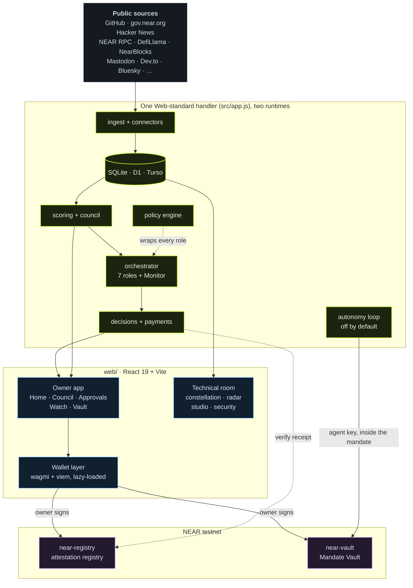

```text
autonear/
├─ src/                    backend, no runtime dependencies on the Node and Cloudflare paths
│  ├─ app.js               one Web-standard request handler (Node, Workers, Vercel)
│  ├─ connectors/          one file per source (timeout, circuit breaker, relevance, weights)
│  ├─ orchestrator/        coordinator + the seven role agents + LLM adapter + treasury
│  ├─ policy.js            tool/host allowlists, budgets, DECISION_LIMITS
│  ├─ council.js           the seven-seat vote and its hashed rules
│  ├─ scoring.js           the published formula
│  ├─ decisions.js         the human gate and receipt verification
│  ├─ autonomy.js          the vault loop (off by default) · autonomy-mode.js (Manual/Auto)
│  ├─ vault/ · agent/      vault adapters (NEAR, EVM) · the agent's own signer and keystore
│  └─ sites/               the cited product brief builder and renderer
├─ contracts/
│  ├─ near-registry/       attestation registry (Rust, no funds, no external calls)
│  ├─ near-vault/          Mandate Vault (Rust) + integration tests
│  ├─ evm/                 Solidity registry and vault (Foundry), off by default
│  └─ vault-conformance*.json   the one file both chains must satisfy
├─ web/                    React 19 + Vite owner app and technical room
├─ tests/                  backend tests + recorded fixtures
├─ migrations/             SQL schema (SQLite / D1 / libSQL)
├─ docs/                   specs, deploy guides, audit archive, testnet proofs, screenshots
├─ video/                  Remotion + Gemini TTS pipeline for the demo video
└─ PROGRESS.md             every claim, its status and its proof command
```

<br>

## Deploy

| Target | Notes | Guide |
| --- | --- | --- |
| **Vercel + Turso** *(current production)* | Git-connected, cron every 15 minutes through `vercel.json` and `api/index.js`. Pin the function region to your Turso region (a mismatch caused HTTP 504 before the fix). | [docs/DEPLOY-VERCEL.md](docs/DEPLOY-VERCEL.md) |
| **Cloudflare Workers + D1** | Same handler, Cron Trigger. The Workers *Free* plan (10 ms CPU, 50 D1 queries per invocation) **cannot** complete a full ingestion tick: use Workers Paid. The read API and UI fit the free tier. | [docs/DEPLOY-CLOUDFLARE.md](docs/DEPLOY-CLOUDFLARE.md) |
| **Any small host** | `npm start`. The only target that can run the autonomy loop and the Rust and Foundry build attestations. | [Quick start](#quick-start) |

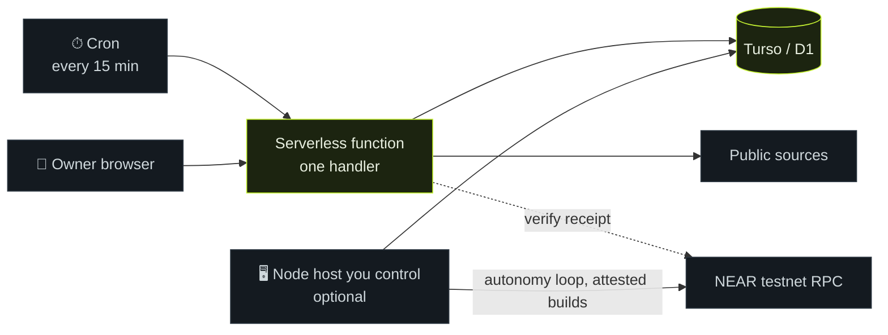

Contract deployment is always a human act: see the Approvals page and `scripts/near-deploy.sh`.

<br>

## Documentation index

| Document | What is in it |
| --- | --- |
| [PROGRESS.md](PROGRESS.md) | Every claim, its status and the command that proves it, by gate |
| [SECURITY.md](SECURITY.md) | What the system can and cannot do, controls, threat model, known limitations |
| [docs/agent-vault-spec.md](docs/agent-vault-spec.md) | Mandate Vault state machine, operations, error codes |
| [docs/contracts-spec.md](docs/contracts-spec.md) | Attestation registry specification |
| [docs/INCIDENT-RUNBOOK.md](docs/INCIDENT-RUNBOOK.md) | What to do when something goes wrong |
| [docs/audit/](docs/audit/) | AI-assisted reviews with every finding's resolution (**not** independent audits) |
| [docs/testnet/](docs/testnet/) | Machine-readable records of real testnet runs with explorer links |
| [docs/HANDOFF.md](docs/HANDOFF.md) | State of the project and accounts for the next session |
| [video/README.md](video/README.md) | How the demo video is produced from real captured numbers |

<br>

## License

MIT for this repository. Upstream engines named in the Engine Registry keep their own licenses (MiroFish is AGPL-3.0: isolate it as a separate service if ever enabled).

<div align="center"><sub>Built for the NEAR Hackathon 2026 · NEAR testnet only · no independent audit · every number above is re-runnable</sub></div>
